# LinkPulse: encurtador de links resiliente na AWS

Projeto prático de estudo: uma aplicação web em três camadas na AWS, com alta disponibilidade, escalabilidade automática e processamento assíncrono. Cria links curtos (`/abc123`). O redirect responde na hora e a contagem de cliques vai para uma fila, sendo processada depois.

Construído para praticar conceitos de arquitetura AWS como SQS, DynamoDB, Systems Manager, Auto Scaling e Load Balancer, aplicados a um encurtador de links.

Região: `us-west-2` (Oregon) | Runtime: Node.js 20 + Express | Ambiente: conta de laboratório (AWS Academy/voclabs)

---

## Arquitetura

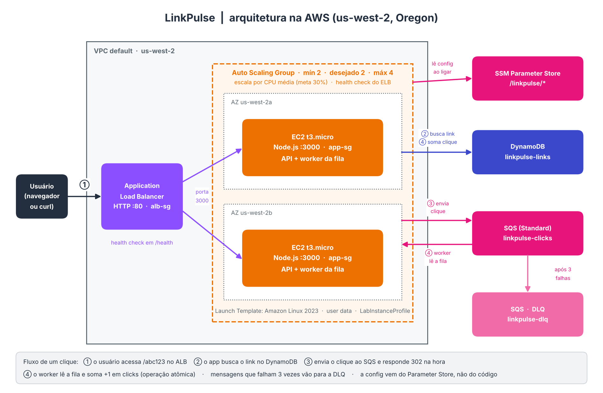

| Camada | Serviço | Papel |
|---|---|---|
| Entrada | Application Load Balancer | Distribui o tráfego e faz health check em `/health` |
| Aplicação | EC2 + Auto Scaling Group | Mantém instâncias em duas zonas e ajusta a capacidade conforme o uso de CPU |
| Dados | DynamoDB | Guarda links e contador de cliques |
| Mensageria | SQS + DLQ | Separa o redirecionamento da contagem de cliques e encaminha mensagens com falha para uma fila dedicada |
| Configuração | SSM Parameter Store | Mantém o nome da tabela e a URL da fila fora do código |

---

## Como funciona

1. `POST /api/links` grava o link no DynamoDB e devolve um código curto.
2. `GET /:code` busca o link, envia o clique para a fila e redireciona (302) sem esperar a contagem.
3. Um worker dentro do app consome a fila com long polling (`WaitTimeSeconds: 20`) e soma o clique com uma operação atômica (`ADD clicks :one`). A mensagem só é removida depois de processada, para que possa voltar à fila se a instância cair no meio do trabalho.
4. Mensagens que falham três vezes vão para a DLQ, evitando que um erro repetido bloqueie o processamento da fila.
5. As configurações são lidas do Parameter Store quando o app liga, sem precisar manter esses valores fixos no código.

### API

| Método | Rota | O que faz |
|---|---|---|
| POST | `/api/links` | Cria um link. Body: `{"url":"https://..."}` |
| GET | `/:code` | Redireciona e registra o clique |
| GET | `/api/links/:code` | Estatísticas (inclui `clicks`) |
| GET | `/health` | Health check do ALB |
| GET | `/api/burn` | Consome CPU de propósito, só para testar o autoscaling |

---

## Construção, passo a passo

### 1. DynamoDB

Tabela `linkpulse-links`, partition key `code` (String) e capacidade On-demand. O código curto é a chave de busca dos links, e a capacidade sob demanda evita a necessidade de provisionar capacidade fixa para este projeto.

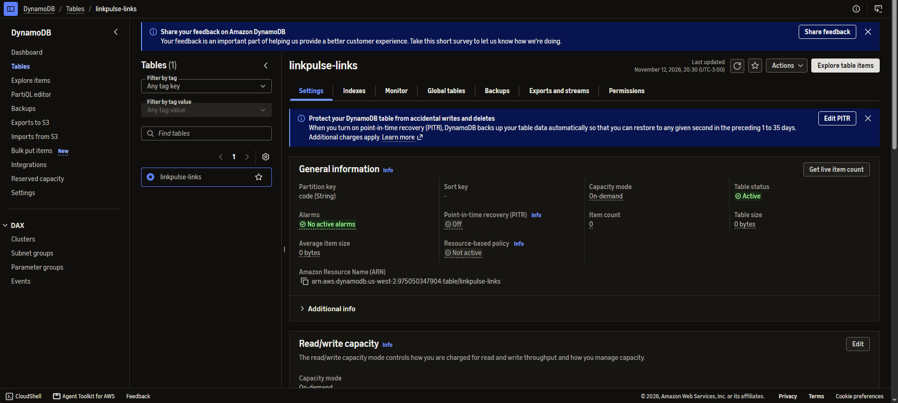

### 2. SQS com Dead-Letter Queue

Filas `linkpulse-clicks` e `linkpulse-dlq` (Standard). A fila principal envia mensagens para a DLQ após três tentativas. O SQS permite que os redirects continuem rápidos mesmo quando a contagem de cliques está aguardando processamento.

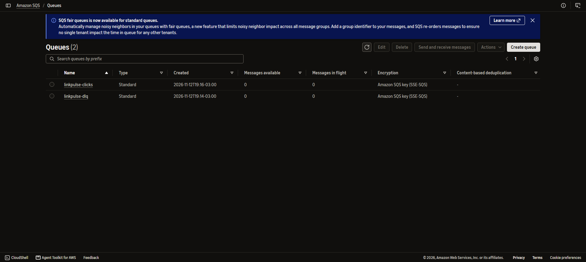

### 3. Parameter Store

Parâmetros `/linkpulse/table-name` e `/linkpulse/queue-url`. Assim, é possível trocar a tabela ou a fila sem alterar o código da aplicação.

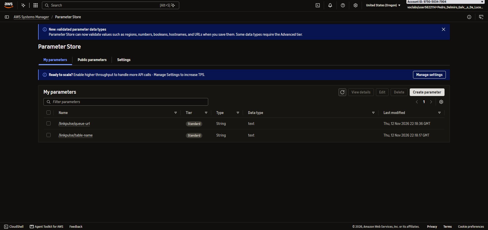

### 4. Security Groups

- `alb-sg`: entrada HTTP (80) de qualquer origem.
- `app-sg`: entrada TCP 3000 somente do `alb-sg`. As instâncias não são acessadas diretamente pela internet.

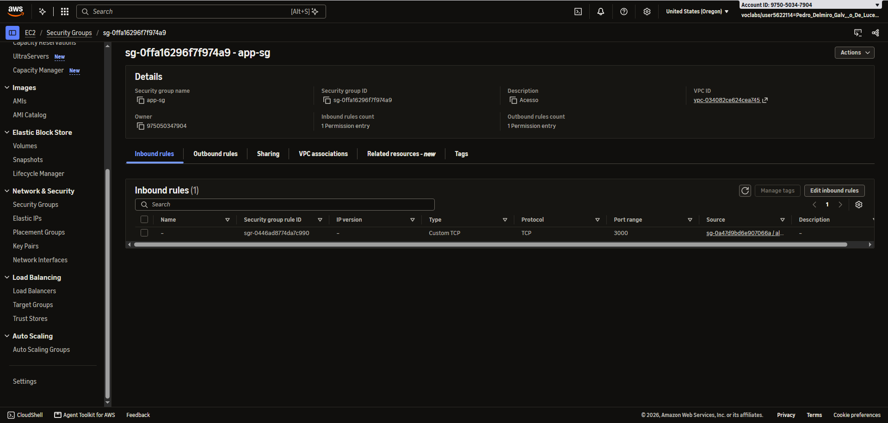

### 5. Launch Template

Amazon Linux 2023, `t3.micro`, `app-sg` e instance profile do laboratório. O user data instala Node.js, clona este repositório, instala dependências com `npm ci` e registra o app como serviço `systemd` com `Restart=always`. Com isso, as instâncias são iniciadas com a mesma configuração e o app volta a subir se o processo falhar. Script em [`infra/user-data.sh`](infra/user-data.sh).

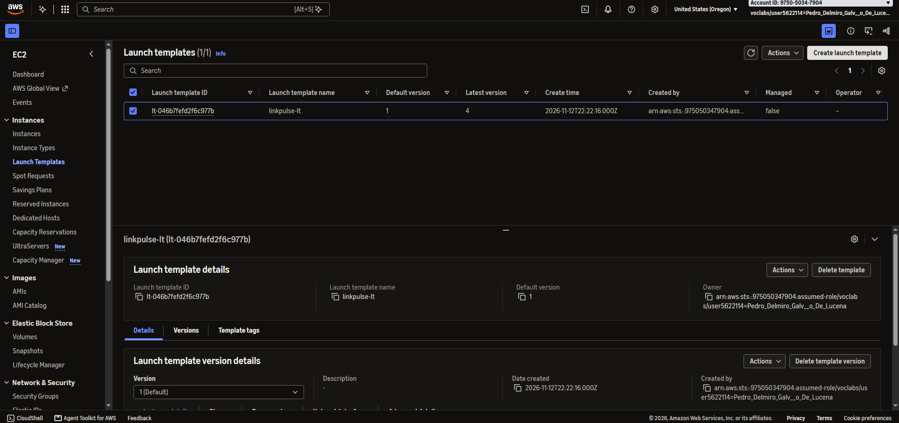

### 6. Application Load Balancer

Internet-facing, em duas zonas de disponibilidade, com listener HTTP 80 para o Target Group `linkpulse-tg` (porta 3000 e health check em `/health`). As duas zonas ajudam a manter o serviço disponível mesmo se uma delas tiver problemas.

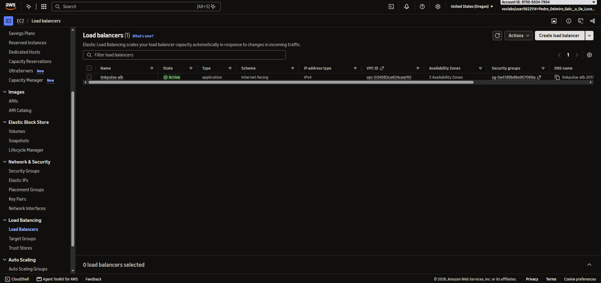

### 7. Auto Scaling Group

Mínimo 2, desejado 2 e máximo 4 instâncias. O health check do ELB permite que o grupo substitua instâncias consideradas indisponíveis pelo Load Balancer. A política de target tracking ajusta a quantidade de instâncias para manter a CPU média em 30%.

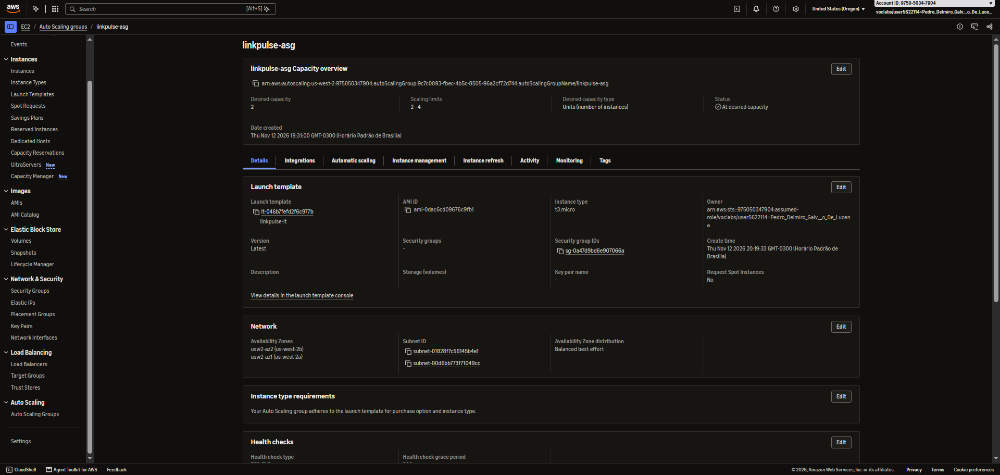

O Target Group também confirma que as duas instâncias estão saudáveis, cada uma em uma zona.

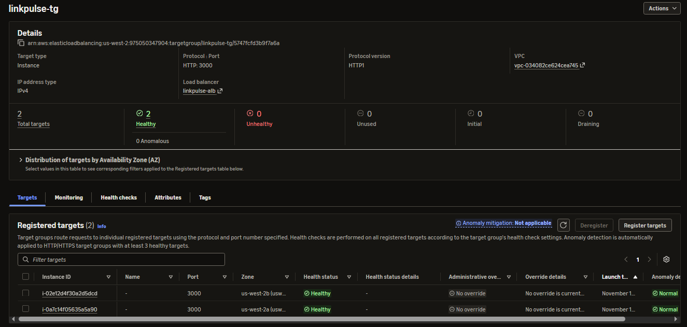

---

## Testes

### Teste funcional

Criação de um link, 5 cliques e consulta das estatísticas pelo DNS do ALB.

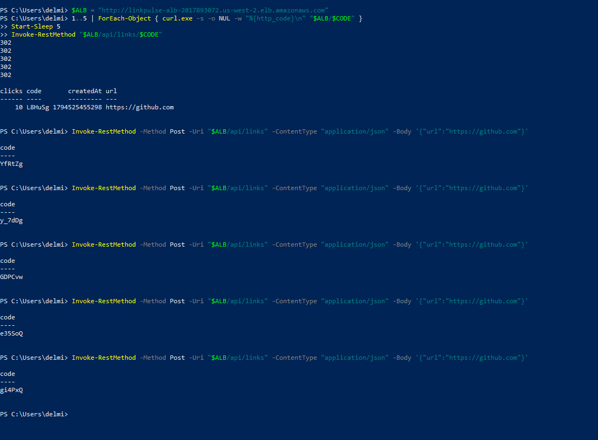

### Teste A: resiliência

Com um loop de requisições a `/health` rodando, uma instância foi terminada manualmente. O site continuou respondendo e o Auto Scaling criou uma substituta.

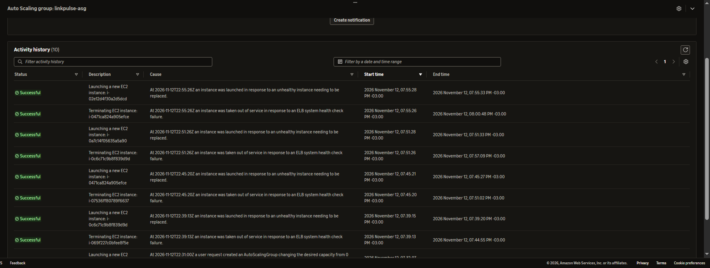

### Teste B: desacoplamento da fila

Com o Delivery delay da fila em 5 minutos, os cliques ficaram retidos na fila. Os redirects continuaram funcionando (302), mas o contador só subiu depois que as mensagens ficaram disponíveis.

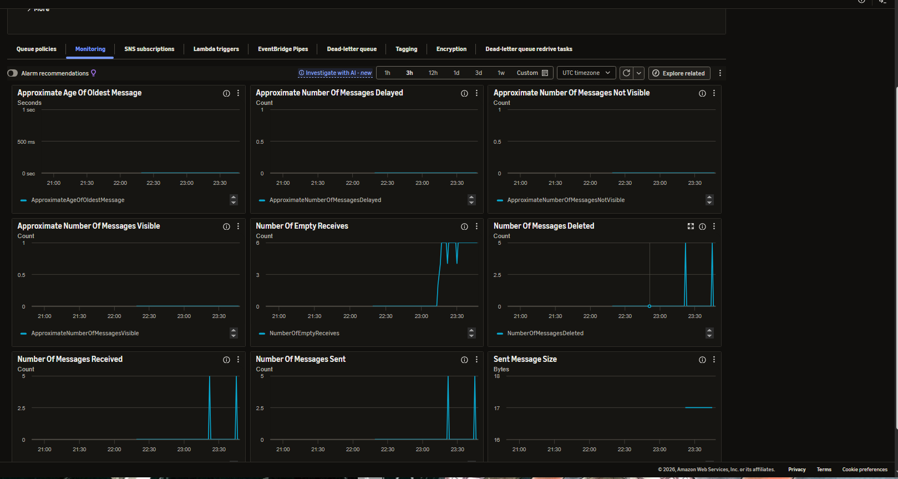

## Trade-offs

- Contagem at-least-once: o SQS Standard pode entregar uma mensagem mais de uma vez, então um clique pode ser contado em dobro em casos raros.
- Instâncias em subnet pública: simplifica o laboratório, mas o ideal é subnet privada com NAT ou VPC endpoints.
- Worker no mesmo processo do app: simples, mas consome CPU do mesmo lugar que atende as requisições. Em produção, seria um serviço separado.
- Role do laboratório: o lab não permite criar roles (`iam:CreateRole`), então usei o instance profile fornecido (`LabInstanceProfile`), mais permissivo que o ideal. Em produção, uma role com menor privilégio, limitada à tabela, à fila e aos parâmetros do app.
- Sem HTTPS: o tráfego é HTTP puro até o ALB.

## Problemas que encontrei e como resolvi

1. Na primeira subida, o Target Group mostrava as instâncias como *unhealthy* com "Request timed out". Eu tinha associado o `alb-sg`, que libera a porta 80, mas a aplicação recebe tráfego na 3000. Troquei pelo `app-sg`, que permite essa conexão vinda do ALB.
2. Também encontrei um erro `NonExistentQueue` no worker. O user data estava fixando `AWS_REGION=us-east-1`, enquanto meus recursos estavam em `us-west-2`, então o app procurava a fila no lugar errado. Ajustei o script para descobrir a região pelo metadata da instância.
3. Mesmo com o Launch Template corrigido, as instâncias antigas continuavam com a configuração anterior. Como alterar o template não atualiza máquinas que já estão rodando, precisei substituí-las para que o ASG criasse novas com a versão corrigida.
4. O laboratório também tinha algumas limitações: não permitia criar roles, bloqueava o *Instance refresh* e estava sem CloudShell. Para seguir com os testes, usei o instance profile fornecido, fiz a troca das instâncias manualmente e rodei os comandos no terminal local.

## Metas futuras

- Infraestrutura como código com Terraform
- Validar o escalonamento sob carga (o endpoint `/api/burn` já existe para isso)
- CloudFront na frente do ALB (HTTPS e borda global), com cache desligado para as rotas dinâmicas
- ALB aceitando tráfego apenas do CloudFront
- Alarme no CloudWatch para mensagens na DLQ
- Worker idempotente, para evitar contagem dupla
- Worker como serviço separado
- Atualizar para Node 22 (o SDK da AWS vai exigi-lo em breve)
- Instâncias em subnets privadas

## Estrutura do repositório

```
linkpulse/
├── app/
│   ├── package.json
│   ├── package-lock.json
│   └── server.js
├── infra/
│   └── user-data.sh
├── docs/              (prints e diagrama)
└── README.md
```
